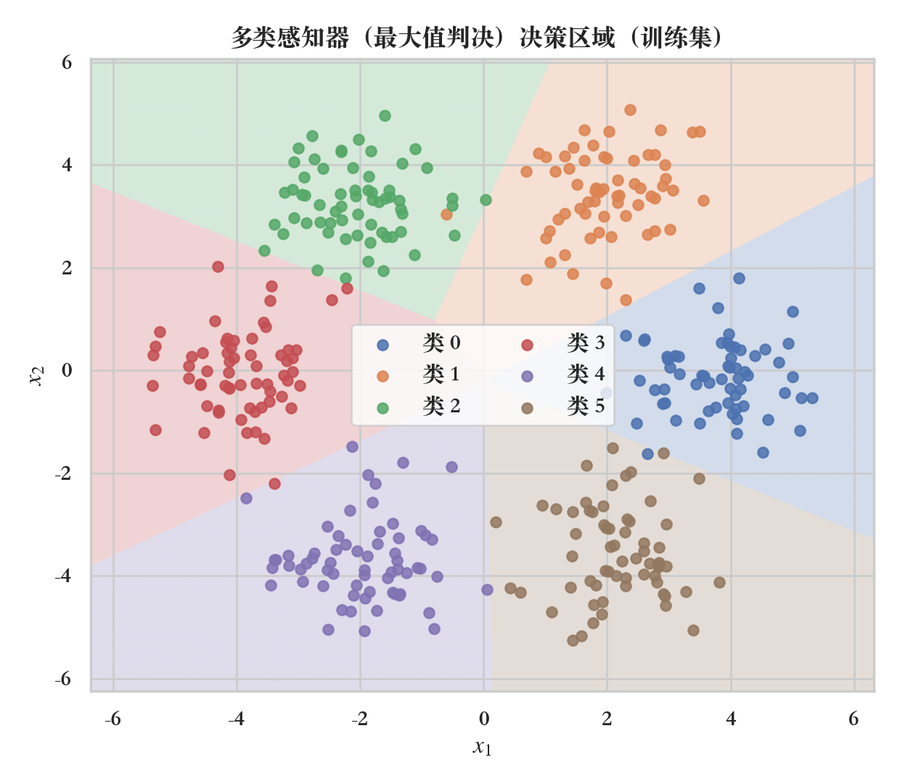
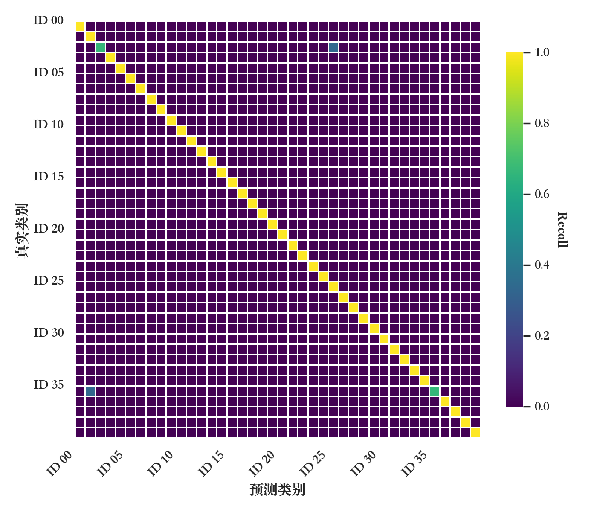
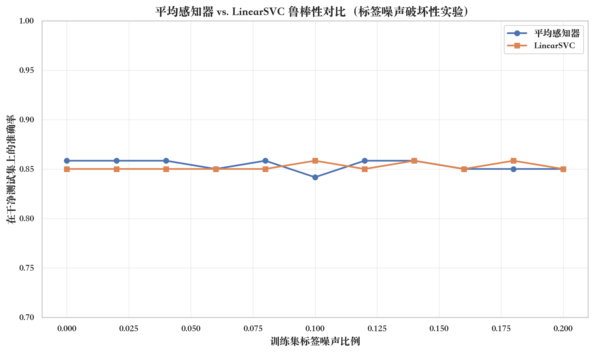
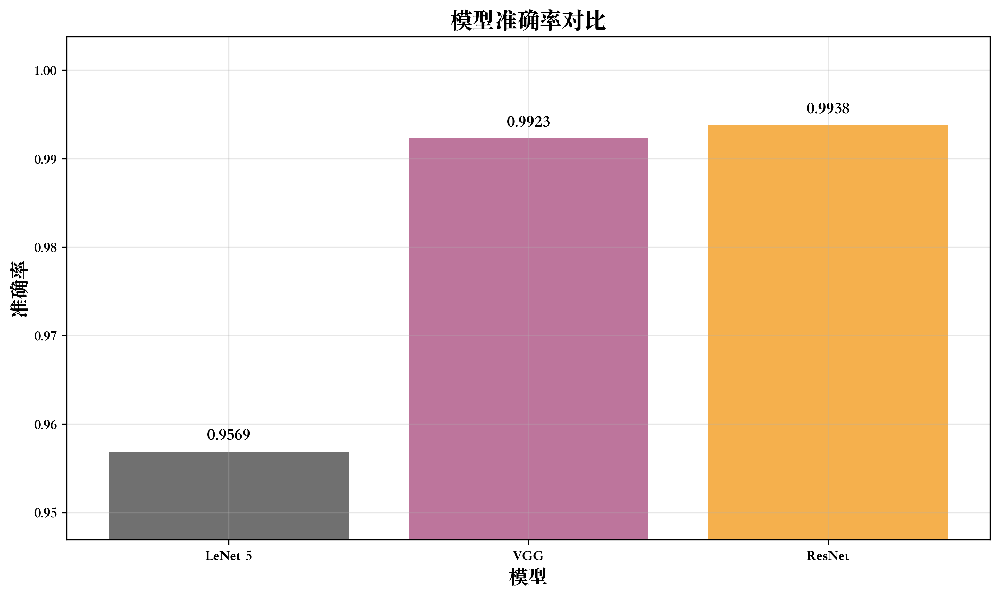
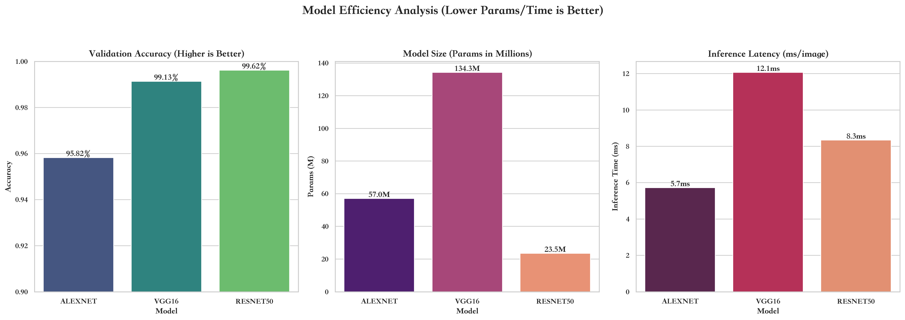
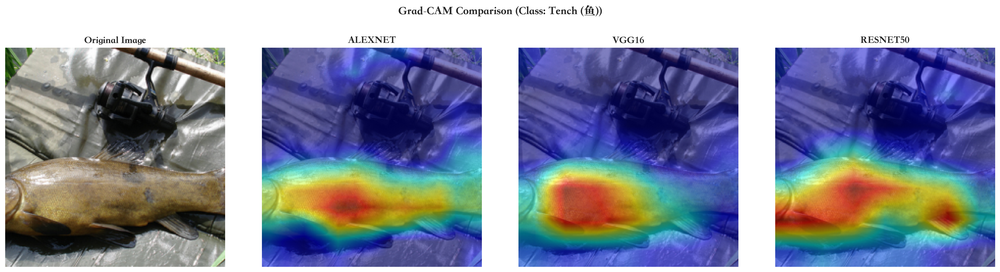
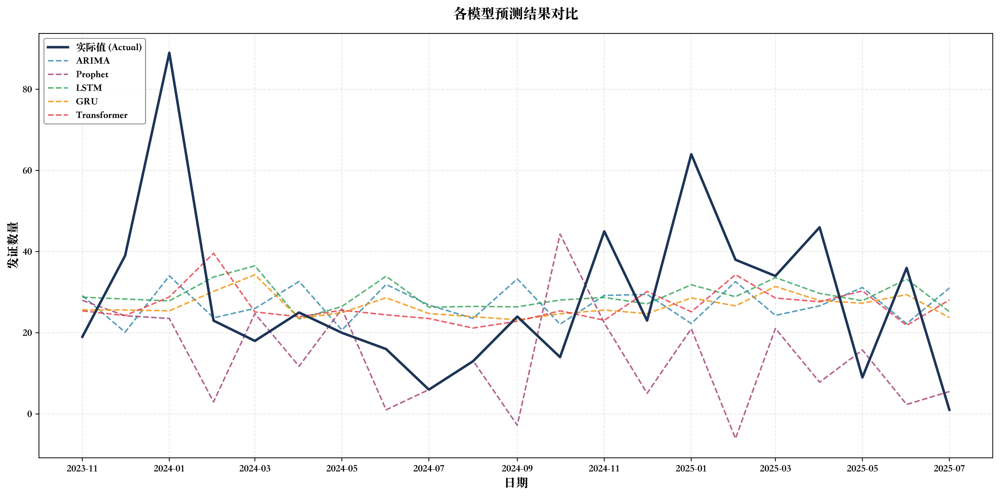

# 人工智能技术课程实验 (AI Tech Labs)

<p align="center">
  <b>感知器 · AdaBoost/SVM 人脸识别 · NumPy 手写 LeNet-5 · ResNet 迁移学习与 Grad-CAM · LSTM/GRU 时序预测</b>
</p>

<p align="center">
  
  
  
  
  
</p>

---

## 1. 仓库简介

本仓库收录《人工智能技术》课程的 5 组独立可复现实验工程，涵盖从经典统计学习、NumPy 底层手写卷积神经网络反向传播，到现代深度残差网络迁移学习与循环神经网络时间序列建模。每个实验子目录均包含完整源码、自动化评测脚本、定量指标表（`assets/tables/`）与可视化图表（`assets/figures/`）。

---

## 2. 实验矩阵与实测指标

以下指标均直接来自各实验子目录 `assets/tables/` 下的实测输出：

| 实验目录 | 核心课题与算法实现 | 测试集 / 数据源 | 核心实测指标 |
| :--- | :--- | :--- | :--- |
| **`lab1_perceptron`** | 原始/口袋/平均/大间隔感知器、Kesler 多类构造、LDA 降维 | 人工合成高斯分布 (含 5%–20% 标签噪声) · Olivetti Faces | 6 类高斯判决准确率 **98.77%** · 10% 噪声下平均感知器 **85.83%** (原始 53.33%) · LDA+感知器人脸识别 **92.50%** |
| **`lab2_adaboost_svm_faces`** | Haar + AdaBoost 人脸检测、PCA 特征脸 (Eigenfaces) + 多核 SVM | ORL Faces (40 人 × 10 张) · 遮挡/光照挑战集 | PCA + RBF-SVM 测试准确率 **98.33%** · 线性核 **97.50%** · 多项式核 **90.83%** |
| **`lab3_lenet5_cnn`** | 纯 NumPy 手写 LeNet-5 (`im2col` 加速与反向传播) vs. PyTorch VGG / ResNet-18 | MNIST (60,000 训练 / 10,000 测试) | NumPy LeNet-5 测试准确率 **95.69%** · PyTorch VGG **99.23%** · ResNet-18 **99.38%** |
| **`lab4_resnet_imagenet`** | AlexNet / VGG16 / ResNet50 迁移学习微调与 Grad-CAM 显著性定位 | ImageNette (ImageNet 10 类高分辨率子集) | **ResNet-50** 验证集 Top-1 准确率 **99.62%** (23.5M 参数, 8.3ms/张) · VGG16 **99.13%** · AlexNet **95.82%** |
| **`lab5_lstm_rnn`** | ARIMA、Prophet、LSTM、GRU、Transformer 五模型时序对比与 ADF 平稳性检验 | 高密市国有土地发证记录 (3,074 条，聚合为 109 个月序列) | **GRU** MAE **14.45** (最优) / RMSE 19.94 · **LSTM** RMSE **19.75** (最优) / MAE 14.83 · Transformer RMSE 20.27 |

---

## 3. 实验结果可视化

### 3.1 决策边界、混淆矩阵与模型收敛对比

| 实验一：Kesler 多类感知器决策区域 (`1240×1080`) | 实验二：ORL 人脸 PCA + SVM 混淆矩阵 (`1400×1200`) |
| :---: | :---: |
|  |  |
| **实验一：平均感知器 vs. LinearSVC 抗噪鲁棒性 (`1968×1168`)** | **实验三：NumPy LeNet-5 vs. VGG / ResNet 准确率 (`2969×1770`)** |
|  |  |

### 3.2 实验四：ImageNette 精度—参数量—延迟对比与 Grad-CAM 热力图

<p align="center">
  
</p>

<p align="center">
  
</p>

### 3.3 实验五：多模型时间序列预测拟合对比 (ARIMA / Prophet / LSTM / GRU / Transformer)

<p align="center">
  
</p>

---

## 4. 目录结构

```text
ai-tech-labs/
├── lab1_perceptron/                 # 实验一：感知器及其变体、Kesler 多类判决与 LDA
│   ├── src/perceptron/              # 感知器核心实现 (Standard / Pocket / Averaged / Margin)
│   ├── experiments/                 # 线性可分、XOR、抗噪对比与 Olivetti 人脸实验脚本
│   └── assets/                      # 生成的决策边界图 (figures/) 与指标表 (tables/)
├── lab2_adaboost_svm_faces/         # 实验二：Haar+AdaBoost 检测与 PCA+SVM 人脸识别
│   ├── src/                         # PCA 特征脸提取与多核 SVM 分类器封装
│   ├── models/                      # Git LFS 托管的预训练分类器权重 (.dat)
│   ├── experiments/                 # ORL 基准测试、主成分维度消融与摄像头实时演示
│   └── assets/                      # 特征脸可视化与核函数对比结果
├── lab3_lenet5_cnn/                 # 实验三：NumPy 手写 LeNet-5 与现代 CNN 对比
│   ├── src/                         # 基于 im2col 的 NumPy 卷积层、池化层、全连接层手写反向传播
│   ├── experiments/                 # run_comparison.py (LeNet-5 / VGG / ResNet-18 对比)
│   └── assets/                      # 卷积核权重图、特征图演化与训练损失曲线
├── lab4_resnet_imagenet/            # 实验四：经典 CNN 迁移学习与 Grad-CAM 可解释性分析
│   ├── src/                         # AlexNet / VGG16 / ResNet50 迁移微调与 Grad-CAM 钩子实现
│   ├── experiments/                 # run_all.py 一键训练、效率评测与热力图生成
│   └── assets/                      # 模型性能 JSON 与多架构 Grad-CAM 对比图
└── lab5_lstm_rnn/                   # 实验五：循环神经网络与统计模型时间序列预测
    ├── src/                         # ARIMA、Prophet、LSTM、GRU、Transformer 建模管线
    ├── experiments/                 # run_all.py (ADF 检验、滑动窗口构建与五模型训练评估)
    └── assets/                      # 预测对比图、训练曲线与 experiment_summary.txt
```

---

## 5. 快速复现指南

### 5.1 拉取仓库与 Git LFS 模型文件

`lab2_adaboost_svm_faces/models/*.dat` 使用 Git LFS 存储，克隆后请拉取 LFS 对象：

```bash
git clone https://github.com/Evan-Joseph/ai-tech-labs.git
cd ai-tech-labs
git lfs install
git lfs pull
```

### 5.2 分实验运行命令

每个实验均配有独立的 `environment.yml` 与 `requirements.txt`：

```bash
# 实验一：感知器全套对比与 LDA 人脸实验
cd lab1_perceptron && python experiments/run_all.py

# 实验二：ORL 人脸 PCA 主成分分析与多核 SVM 网格搜索
cd ../lab2_adaboost_svm_faces && python experiments/pca_svm_analysis.py

# 实验三：NumPy LeNet-5 与 PyTorch VGG / ResNet-18 训练评估 (支持 --quick-test 快速验证)
cd ../lab3_lenet5_cnn && python experiments/run_comparison.py --epochs 20

# 实验四：ImageNette 自动下载、三模型微调与 Grad-CAM 生成
cd ../lab4_resnet_imagenet && python experiments/run_all.py

# 实验五：土地发证月度时序平稳性检验与五模型预测对比
cd ../lab5_lstm_rnn && python experiments/run_all.py
```

---

## 许可证

本仓库采用 [MIT License](LICENSE) 开源。
